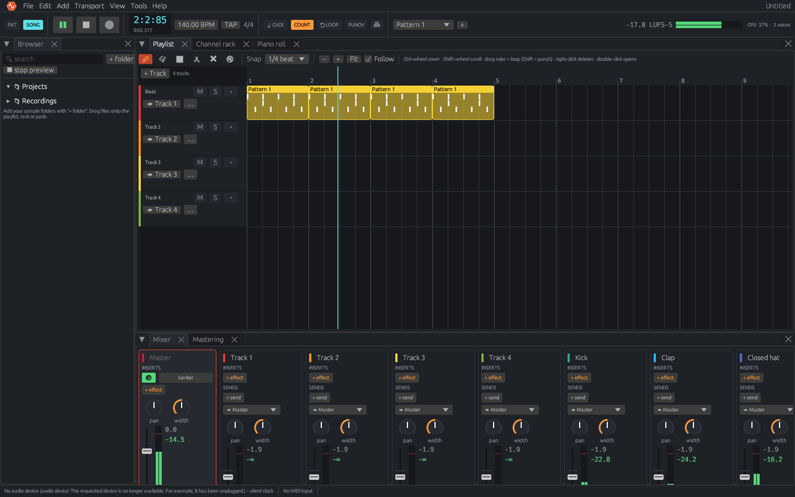
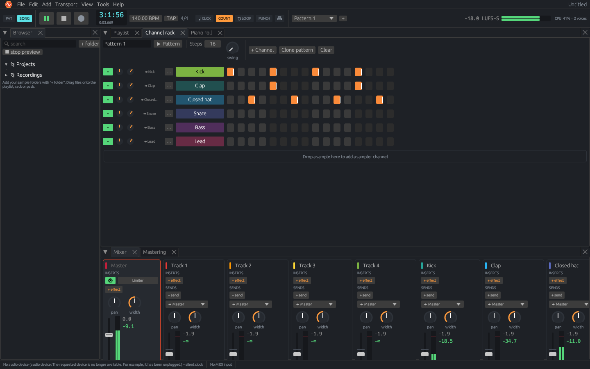
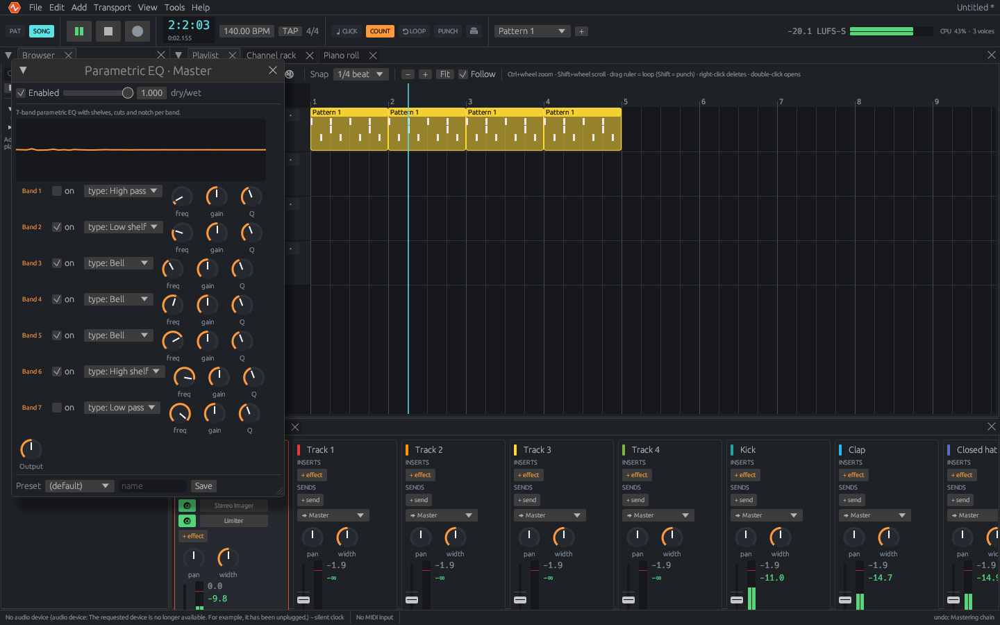
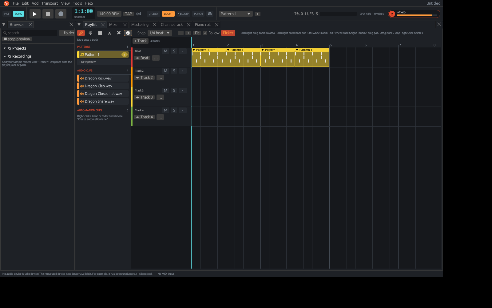
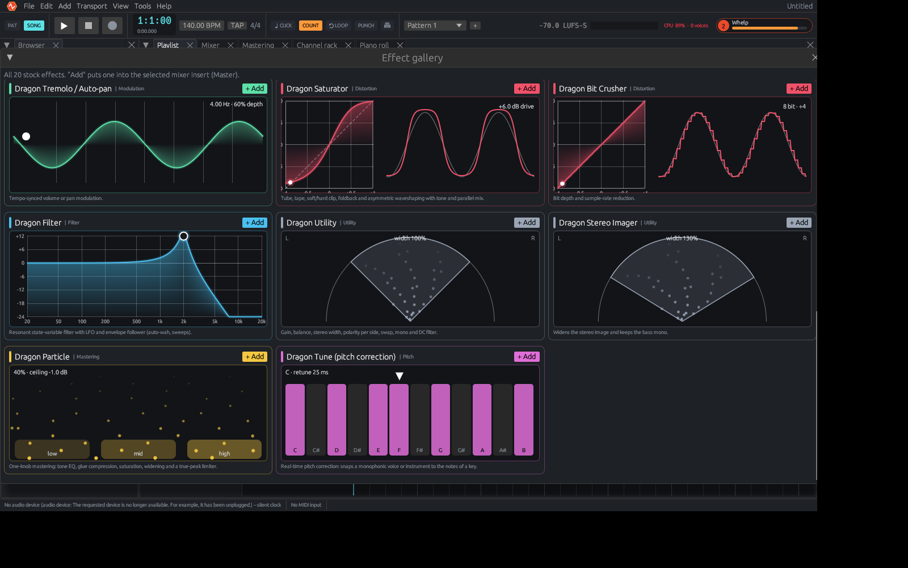
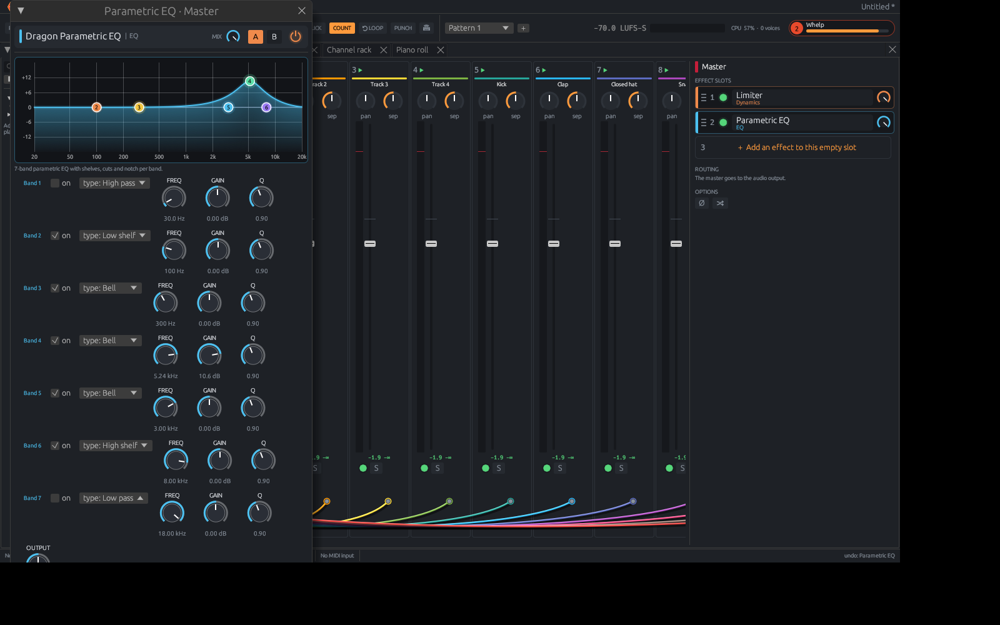
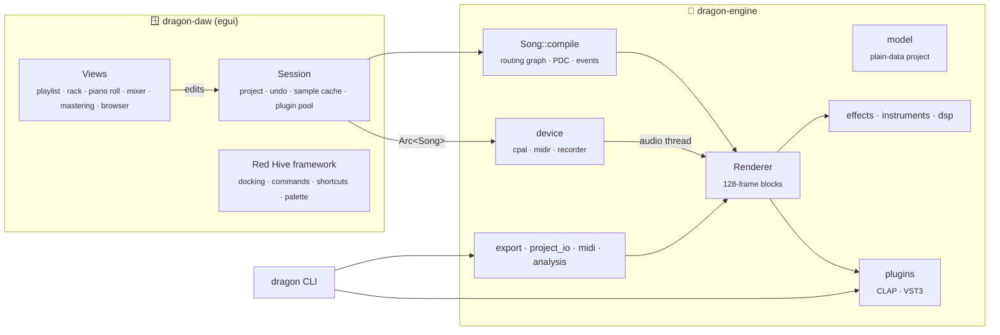

<div align="center">


# Dragon DAW

**An offline digital audio workstation written in Rust: record, make beats, mix and master.
It's built on the Red Hive desktop framework and hosts CLAP and VST3 plugins.**

[](https://github.com/zenoxart/DragonDAW-RS/actions/workflows/ci.yml)
[](https://github.com/zenoxart/DragonDAW-RS/actions/workflows/release.yml)
[](https://github.com/zenoxart/DragonDAW-RS/releases/tag/nightly)
[](https://www.rust-lang.org/)
[](https://github.com/emilk/egui)
[](#-plugins)
[](#-features)
[](LICENSE)

[Features](#-features) ·
[Screenshots](#-screenshots) ·
[Architecture](#%EF%B8%8F-architecture) ·
[Quick start](#-quick-start) ·
[Plugins](#-plugins) ·
[Command line](#%EF%B8%8F-command-line) ·
[Feature coverage](docs/FEATURES.md)

</div>

---

Dragon DAW is a desktop DAW that runs entirely on your machine, with no server, no account and no network.
It brings together a FL Studio-style beat workflow (channel rack, step sequencer, pattern clips, piano roll)
and Pro Tools-style recording and editing (armed tracks, count-in, punch, takes and comping, sample-accurate
playlist). The mixer has sends, sidechains, VCAs and plugin delay compensation. For mastering there's
BS.1770 loudness metering and loudness-normalised export.

This repository started as the **Red Hive** framework. The enterprise parts (backend services, sign-in, users,
documents, invoices, reports, workflows and module hot-swap) have been removed. The desktop framework is kept:
docking, command pool, shortcuts, palette, navigation and i18n. Dragon DAW is now the one app it hosts.

## ✨ Features

| | |
|---|---|
| 🥁 **Make beats** | Channel rack with step sequencer (per-step velocity, swing, pattern length up to 64 steps), drop a sample on a channel to replace its sound, patterns as clips with **clone / make unique / split by channel / split at a bar**, pattern / song mode, a built-in synthesised **Dragon Kit** so a fresh install makes sound with no sample library, sampler (slices, glide, an FL-style **volume envelope** drawn over the waveform with bend handles and envelope presets), subtractive synth (3 oscillators, unison, SVF filter, filter and amp envelopes, LFO), FPC-style drum pads with velocity layers and choke groups |
| 🎹 **Piano roll** | Draw / paint / select / slice / erase / mute tools, drag selected notes (Shift = copy), arrow-key nudge, snap, **key + scale** picker (26 scales) with highlighted rows and snap-to-scale, chord stamps, chord progressions, arpeggiator, strum, flam, quantize, legato, humanize, slide notes, velocity lane, ghost notes from other channels, typing keyboard to piano, retro MIDI capture |
| 🎙️ **Record** | Arm tracks, choose stereo or mono inputs, monitoring modes, metronome with count-in, loop and punch ranges, automatic round-trip latency compensation, takes stacked into lanes with **comping** by dragging a range, MIDI note recording into patterns |
| ✂️ **Arrange & edit** | Playlist with audio, pattern and **automation clips**, a **picker panel** on its left listing every pattern (split ones included), the project's audio files and its automation clips – drag any of them onto a track, FL-style **Ctrl + right-drag zoom to area** (also in the piano roll), middle-drag panning, move / trim / resize / split / duplicate / mute, **multi-select** (Ctrl+drag) and multi-track moves, Shift+drag to clone, an FL-style **slice tool** that cuts across tracks (also in the piano roll), drag several patterns / audio / automation clips from the picker at once, cross-track moves, clip gain, pan, fades with three curves, reverse, pitch, varispeed and pitch-preserving **time-stretch** (WSOLA), fit-to-tempo with BPM detection, markers, tempo and time-signature changes, unlimited undo with a history list |
| 🎛️ **Mix** | FL Studio-style mixer: insert strips with **hanging routing cables** (pull a cable from a strip's jack onto another strip to route it; signal flows along the cables while audio plays), route arrows and send knobs, the selected insert's **large effect slots on the right** (category colour, drag to reorder, bypass LED, mix knob, gain-reduction bar, replace), click-free parameter smoothing, pre/post-fader sends, output routing to buses, sidechain inputs, VCA faders, stereo width, polarity, L/R swap, solo-safe, peak and gain-reduction meters, **plugin delay compensation** across the whole routing graph, automation lanes (read / write / touch / latch / trim), MIDI learn |
| 🧪 **25 stock effects** | **Dragon Tune** real-time pitch correction for tracking (≈2.7 ms, humanize, flex-tune, vibrato, note stabilizer, doubler, MetaTune-style display with a note heat map), 24-band parametric EQ after Pro-Q (**live analyzer**, spectrum grab, dynamic bands, mid/side, zero-latency / natural / linear phase, **EQ match** and collision view against another track's EQ, piano scale), compressor with eight styles, look-ahead and a **scrolling level / gain-reduction history**, a multiband saturator after Saturn, **multiband dynamics** after Pro-MB (four bands, compress / expand, upward / downward), a **gate** after Pro-G (hysteresis, look-ahead, styles, flip), limiter (eight styles, 2×/4× oversampling, unity-gain listen), a **de-esser** after Pro-DS (single-vocal / allround, split / wide band, look-ahead), a **transient designer** (attack / sustain amount, sensitivity, duration and shape, clip guard, listen modes), reverb (with decay-rate EQ), a delay after Timeless (cross feedback, drive, diffusion, ducking, freeze, pitch in the loop), chorus, flanger, phaser, tremolo, saturator with **nine tube models**, bitcrusher, a dual filter after Volcano (seven types, 12–48 dB/oct, four styles, serial / parallel), utility, stereo imager with a **phase meter** (goniometer + correlation), **Dragon Particle** one-knob mastering, **Class-A Strip** (transformer preamp + stepped EQ + tube opto compressor for recording), **Drum Bus**, **Clean Voice** (post-production vocal chain after zenoxart/CleanVoice) and **Alter** (pitch + formant shifter, robot mode). Every editor has an animated, interactive display, **A/B compare**, a power button and mix knob, presets, a **full-screen** button; every knob: drag (Shift = fine), wheel, double-click or Ctrl+click resets, right-click to **type a value**. The **Effect gallery** (View menu, F8) browses and adds them |
| 🏁 **Master** | Momentary / short-term / integrated LUFS and true peak (ITU-R BS.1770), loudness targets for streaming, broadcast and club, a spectrum analyser, a **reference track** comparison (pick a region; loudness, RMS, crest, LRA, stereo and tonal balance side by side, with suggestions and loudness-matched A/B), a one-click mastering chain, and export normalised to a LUFS target or peak |
| 💾 **Export** | WAV 16 / 24 / 32-float, FLAC 16 / 24, MP3, Ogg Vorbis, 44.1–96 kHz, song / loop / pattern range, tail, TPDF dither, mono, **stems** (one file per mixer channel), bounce-in-place, MIDI export |
| 🔌 **Plugins** | CLAP and VST3 instruments and effects, **crash-isolated scanning** (each file in its own process), plugin GUIs embedded in native host windows (Linux X11, Windows) that **resize with the plugin** and can go **full screen**, generic parameter editors, sidechain into plugins, full plugin state saved in the project, latency reported to PDC |
| 🎤 **Vocal & audio tools** | "Dragon Tune" pitch correction (key, scale, retune speed), audio-to-MIDI (melody and drums), offline stem separation (drums / harmonic / centre) |
| 🎛️ **Performance & hardware** | Clip launcher (tracks × patterns, launch on the bar), Mackie Control surfaces with motor faders and LEDs |
| 🔊 **Surround & Atmos** | 5.1, 7.1 and 7.1.4 mixes: a surround panner (position, height, spread, LFE) on every top-level mixer channel, multichannel WAV export, and Dolby Atmos object export as ADM BWF |
| 🎬 **Video** | Import a video, watch it in sync with the playhead with timecode, its soundtrack on a track, export the video with your mix (uses ffmpeg) |
| 🛟 **Safety** | **FL-style project folders**: saving a new project creates `<Name>/<Name>.dragon` with `Samples/`, `Recordings/`, `Renders/` and `Backup/` and copies every used file in, autosave with crash detection and a recovery dialog, numbered backups on save, relative paths, missing-file relinking, "collect all files" into the project folder |
| 🐉 **Dragon Quests** | Optional gamification: quests that teach the workflow (first beat, arranging, routing with cables, automation, mastering against a reference, export…), XP and dragon levels, a daily streak and animated celebrations (off with *Reduce motion*) |
| 🪟 **Desktop shell** | VS-style docking with **Playlist, Mixer, Mastering, Channel rack and Piano roll as tabs side by side** by default (tabs, splits, floating windows, saved layout), generated menus, a command palette (`Ctrl+Shift+P`), rebindable and chorded shortcuts **matching FL Studio** (Ctrl+B duplicate, Ctrl+Alt+Z undo, P/B/D/T/C/E tools, F5–F12, Ctrl+R export, Ctrl+N save new version …), a BPM display that drags whole BPM from the integer part and decimals from the fraction, with tempo presets 70–160 on right-click, a browser **waveform preview**, drag & drop from the file manager and browser, an animated splash (Higgsfield AI) |

The full list, compared item by item with the prioritised roadmap, is in **[docs/FEATURES.md](docs/FEATURES.md)**.

## 📸 Screenshots

> Real screenshots of the app (Linux, software rendering, no sound card, so the silent clock is running).

<table>
  <tr>
    <td width="50%"></td>
    <td width="50%"></td>
  </tr>
  <tr>
    <td align="center"><b>Playlist</b> — pattern clips, live meters and loudness while playing</td>
    <td align="center"><b>Channel rack</b> — the starter beat on the built-in Dragon Kit</td>
  </tr>
  <tr>
    <td width="50%"></td>
    <td width="50%"></td>
  </tr>
  <tr>
    <td align="center"><b>Piano roll</b> — a generated vi–IV–I–V progression</td>
    <td align="center"><b>Mixer</b> — one-click mastering chain, 7-band EQ editor</td>
  </tr>
  <tr>
    <td width="50%"></td>
    <td width="50%"></td>
  </tr>
  <tr>
    <td align="center"><b>Routing cables</b> — drag a cable between strips; big effect slots</td>
    <td align="center"><b>Picker</b> — patterns, audio and automation clips to drag into the playlist</td>
  </tr>
  <tr>
    <td width="50%"></td>
    <td width="50%"></td>
  </tr>
  <tr>
    <td align="center"><b>Effect gallery</b> — every stock effect with its live display</td>
    <td align="center"><b>Effect gallery</b> — saturation curves, filter, stereo field, Dragon Tune</td>
  </tr>
  <tr>
    <td width="50%"></td>
    <td width="50%"></td>
  </tr>
  <tr>
    <td align="center"><b>Effect editor</b> — drag EQ nodes, A/B compare, power button</td>
    <td align="center"><b>Dragon Quests</b> — quest celebration with embers and XP bar</td>
  </tr>
</table>

The look of the effect editors and the quest celebration follows design references generated with
**Higgsfield AI**: an [effect-suite UI sheet](docs/images/design/higgsfield-effect-suite-reference.jpg)
(header with category stripe and power button, axis-labelled graphs with gradient fills, LED-segment
gain-reduction meter, lollipop delay taps, dense reverb tail, labelled knobs with values, A/B) and an
[animated level-up GIF](docs/images/design/higgsfield-levelup-reference.jpg) (capsule card dropping in,
glowing orange border, ember burst, cyan XP bar with a shine). Both are re-created procedurally in egui so
they scale, animate live and respect *Reduce motion*.

## 🏗️ Architecture



- **The project is plain data.** Every edit snapshots the project for undo, and the session compiles it into an
  immutable `Song` (routing order, delay lines for plugin delay compensation, pattern events, clip timing). The
  audio thread swaps it in without locking the UI.
- **One renderer for everything.** Real-time playback, export, stems, bounce-in-place and the CLI all run the same
  `Renderer`, so what you hear is what you export.
- **Processors survive recompiles.** A pool keeps effect, instrument and plugin instances by id. Turning a knob
  recompiles the song but doesn't reset reverb tails or reload plugins.
- **No device? Keep working.** If no audio device can be opened, a silent clock drives the same renderer. The
  transport, meters, editing and export all keep working.

More detail is in [ARCHITECTURE.md](ARCHITECTURE.md).

## 🚀 Quick start

**Download a build:** the [latest nightly](https://github.com/zenoxart/DragonDAW-RS/releases/tag/nightly)
(built from `main` after every green CI run) or a [versioned release](https://github.com/zenoxart/DragonDAW-RS/releases)
– Windows x64, Linux x64, macOS Apple Silicon and Intel. Or build it yourself:

```bash
# Linux: ALSA headers for audio and MIDI
sudo apt install libasound2-dev

cargo run --release -p dragon-daw            # the DAW
cargo run --release -p dragon-daw -- song.dragon
cargo build --release -p dragon-cli          # the `dragon` tool (put it next to the app for isolated plugin scans)
```

Optional: install **ffmpeg** (with `ffprobe`) for the video features.

**If a project crashes the app** (usually a third-party plugin): the next start says which plugin was
loading and offers to open the project in safe mode, with plugins off or without their saved settings.
`dragon-daw --safe song.dragon` does the same from the command line. Crash reports go to the `Crash`
folder in Dragon DAW's local data (`%LOCALAPPDATA%\DragonDAW\Crash` on Windows).

When you press **Space**, the starter project plays a beat. Some useful keys:

| Key | Action | Key | Action |
|---|---|---|---|
| `Space` | play / pause | `F5` `F6` `F7` `F9` | playlist, channel rack, piano roll, mixer |
| `R` | record | `L` | pattern / song mode |
| `Ctrl+Z` / `Ctrl+Y` | undo / redo | `Ctrl+T` | typing keyboard to piano |
| `Ctrl+S` | save | `Ctrl+R` | export |
| `Ctrl+Shift+P` | command palette | `F8` / `F10` | plugin manager / options |
| `F12` | performance (clip launcher) | `F4` | new pattern |
| `Ctrl` + right-drag | zoom into the box (playlist, piano roll) | `Ctrl` + right-click | zoom out |
| middle-drag | pan | `Alt` + wheel | track / key height |
| `←` `→` `↑` `↓` | nudge selected notes (`Shift` = octave) | `Shift` + drag | copy notes |

Every shortcut can be changed in **Options › Keyboard shortcuts**.

### Splash animation

The splash animation was generated with **Higgsfield AI**. Put it in `crates/app/assets/splash.gif` (or in
`assets/splash.gif` next to the executable) and Dragon DAW plays it on start. Without the file it draws the
animated logo itself.

## 🔌 Plugins

Dragon DAW looks for plugins in the standard CLAP and VST3 folders of each platform, plus any folders you add in
**View › Plugin manager**. Scanning runs `dragon scan-plugin <format> <path>` in a child process for each file,
so a plugin that crashes while loading is just skipped. Instruments go into the channel rack; effects go into
any mixer insert slot. The host:

- sends notes and sample-accurate parameter events,
- reports the plugin's latency to delay compensation,
- stores the plugin's full state in the project,
- passes a sidechain signal (CLAP second input port, VST3 aux bus),
- embeds the plugin's own GUI in a native window (X11 on Linux with the VST3 run loop and CLAP timer / fd
  extensions, Win32 on Windows; macOS falls back to CLAP floating windows and the generic editor).

The host is tested against small CLAP and VST3 plugins in [`crates/test-plugins`](crates/test-plugins). They're
written for this repository: a gain effect and a sine instrument.

## ⌨️ Command line

```text
dragon render <project> <out.wav|out.flac|out.mp3|out.ogg|folder> [--format wav16|wav24|wav32|flac16|flac24|mp3|ogg]
              [--rate 48000] [--lufs -14] [--peak -1] [--stems] [--mono] [--no-plugins]
dragon info <project>          tracks, patterns, length, missing files
dragon new <project>           writes an empty project
dragon loudness <audio>        integrated LUFS, true peak, sample peak
dragon analyze <audio>         BPM and key detection
dragon scan [folder …]         plugin scan, each file in its own process
```

## 📁 Repository layout

```text
crates/
├── engine/             dragon-engine: model, renderer, DSP, effects, instruments, plugins, device I/O, export
├── app/                dragon-daw: the desktop app (views, session, audio backend, splash)
├── test-plugins/       CLAP + VST3 plugins used by the host tests
├── client/framework/   Red Hive desktop framework (docking, commands, shortcuts, i18n, widgets)
└── shared/
    ├── contracts/      command, shortcut and UI primitives
    └── monads/         Res<T>, Error, Validator
tools/dragon-cli/       the `dragon` command-line tool
docs/                   feature coverage, images
```

## 🧪 Development

```bash
cargo test --workspace                 # engine, host-with-real-plugins, framework and app tests
cargo clippy --workspace --all-targets -- -D warnings
cargo fmt --all                        # rustfmt.toml: 220 columns
```

The engine tests render audio and assert on the result: sample-accurate clip and step timing, swing, routing and
solo, plugin delay compensation alignment, automation, loop wrap, effect stability at extreme settings, limiter
ceiling, LUFS, time-stretch, WAV / FLAC / stem export, MIDI round trips, BPM and key detection, comping and
autosave crash detection. The plugin tests load the in-repo CLAP and VST3 plugins through the real host.

### CI/CD

GitHub Actions runs on every push to `main` and every pull request – see the
[CI runs](https://github.com/zenoxart/DragonDAW-RS/actions/workflows/ci.yml),
[release runs](https://github.com/zenoxart/DragonDAW-RS/actions/workflows/release.yml) and
[releases](https://github.com/zenoxart/DragonDAW-RS/releases):

| Workflow | Jobs |
|---|---|
| [`ci.yml`](.github/workflows/ci.yml) | rustfmt check and Clippy (`-D warnings`), the full test suite on Linux under Xvfb (including the CLAP/VST3 host tests), tests on Windows and macOS, and a build check on the minimum Rust version (1.89) |
| [`release.yml`](.github/workflows/release.yml) | **continuous delivery**: after every green CI run on `main`, release builds for all four platforms are published as the rolling [`nightly`](https://github.com/zenoxart/DragonDAW-RS/releases/tag/nightly) pre-release (replaced each time, with `SHA256SUMS.txt`). On a `v*` tag: release builds of `dragon-daw` and the `dragon` CLI for Windows x64, Linux x64, macOS Apple Silicon and macOS Intel, packaged as zip / tar.gz with `SHA256SUMS.txt` and published as a GitHub release (tags with a `-`, such as `v2.1.0-beta.1`, become pre-releases) |

Dependabot opens weekly grouped updates for Cargo crates and the actions themselves.

To publish a release:

```bash
git tag v2.1.0
git push origin v2.1.0
```

## 🤝 Contributing

Issues and pull requests are welcome. Please keep code, comments and docs in English, run the tests and clippy,
and add a test for new engine behaviour that renders audio and checks it.

## 📄 License

Copyright © ZenoxArt. Licensed under the [Apache License, Version 2.0](LICENSE).
