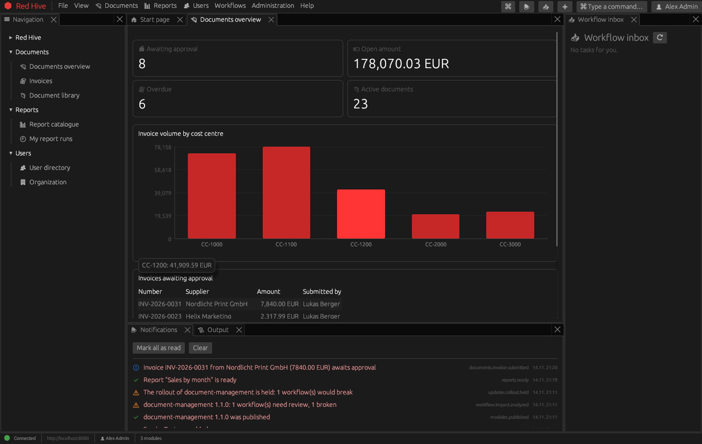
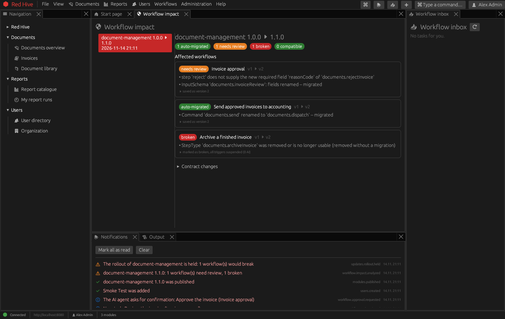
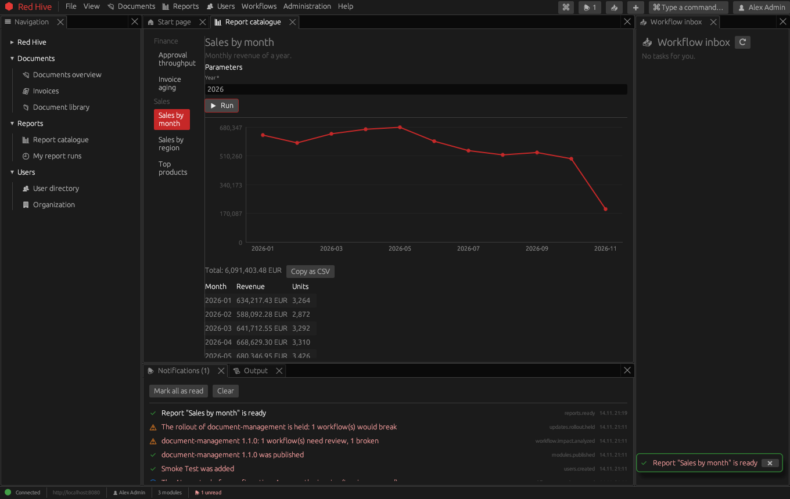
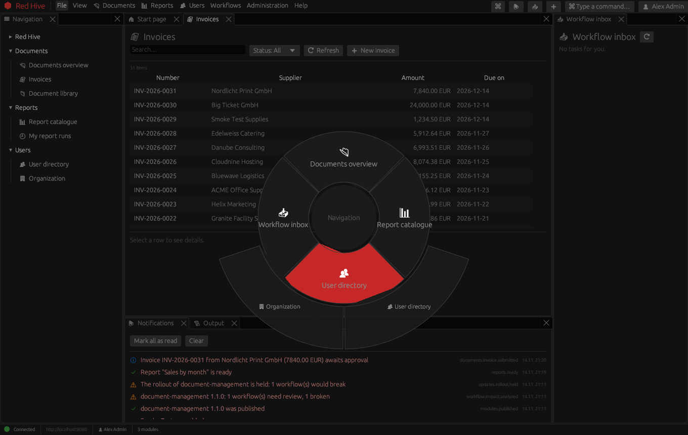
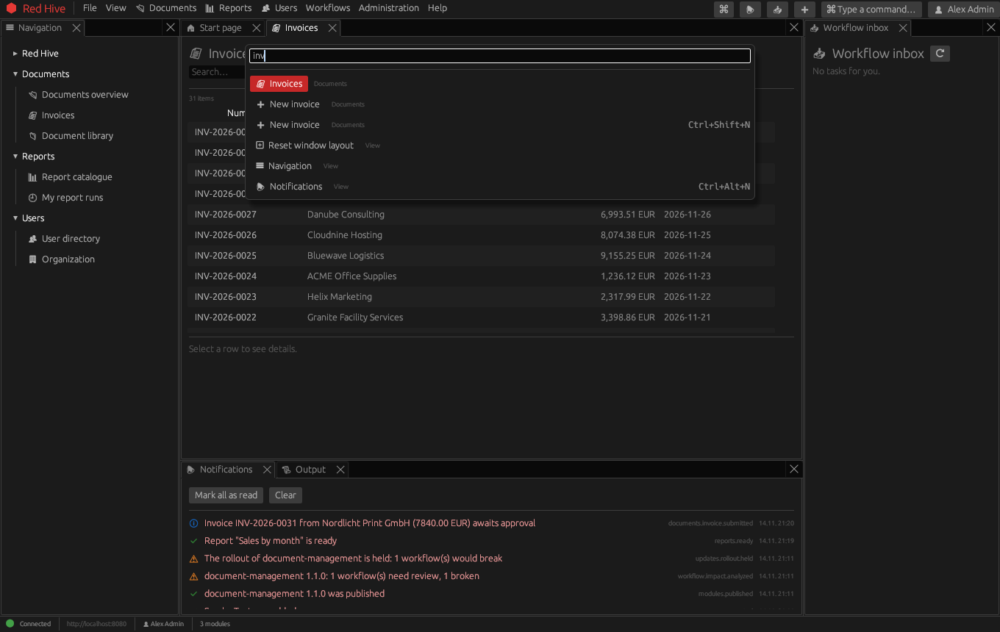
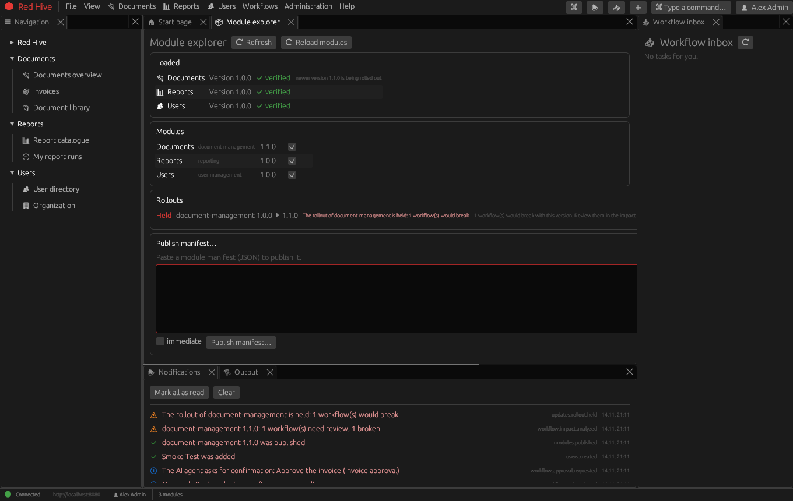
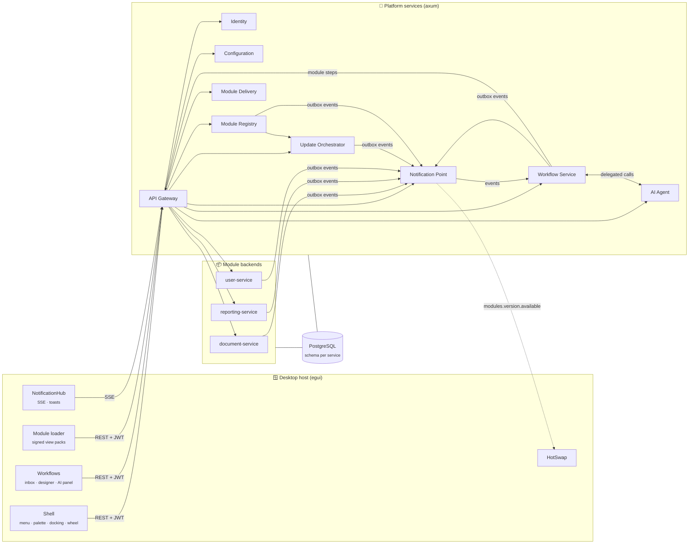
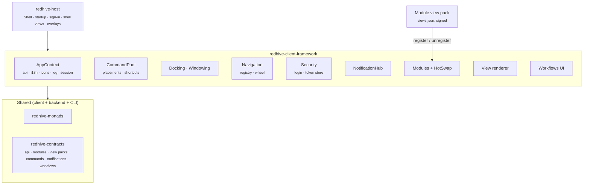
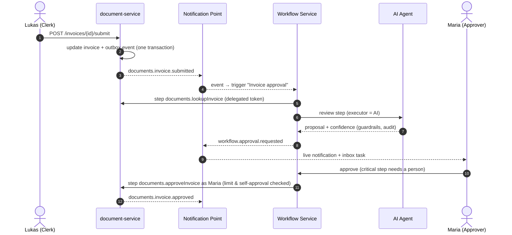
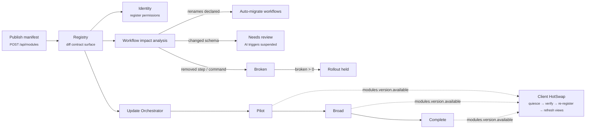

<div align="center">


# Red Hive

**A modular, server-driven enterprise framework written in Rust — with hot-swappable modules,
user-designed workflows and an AI agent that works within guardrails.**

[](https://www.rust-lang.org/)
[](https://github.com/emilk/egui)
[](https://github.com/tokio-rs/axum)
[](deployment/docker/docker-compose.yml)
[](deployment/docker/database)
[](LICENSE)

[Features](#-features) ·
[Screenshots](#-screenshots) ·
[Architecture](#%EF%B8%8F-architecture) ·
[Quick start](#-quick-start) ·
[Build a module](#-build-your-own-module) ·
[Workflows](#-integrate-your-module-with-workflows)

</div>

---

Red Hive is a long-running desktop host that **loads its features from the server at runtime**. Every feature
is a *module*: a declarative *view pack* for the client, an axum backend in its own container and a manifest
that describes its commands, views, events and workflow steps. Users get the modules (and versions) the server
assigns to them. New versions are rolled out in stages and **swapped into the running app**. Before a new
version goes out, the server checks which workflows it would break.

Red Hive is the Rust rebuild of [Golden Hive](https://github.com/zenoxart/GoldenHiveFramework): the same
platform, a single language from the database to the window, and no native module code inside the host.

## ✨ Features

| | |
|---|---|
| 🧩 **Runtime modules** | Modules ship signed packages (SHA-256 + ECDSA P-256, key pinned on first use) with a *view pack* — dashboards, lists, forms and report runners — so no foreign code ever runs in the host; dependency resolution, compatibility rules, development modules from disk |
| 🔁 **Hot-swap & staged rollouts** | Pilot → Broad → Complete rollouts per user group; running modules are quiesced (open actions finish first) and replaced without a restart, with rollback |
| 🧭 **Workflows designed in the app** | Input, choice, review, approval, module steps, commands, sub-workflows, wait-for-event; triggers on events, commands, schedules and conditions; a safe expression language; a recorder |
| 🤖 **AI agent with guardrails** | Offline rules provider or any OpenAI-compatible endpoint; kill switch, autonomy levels, confidence thresholds, daily limits, approvals for critical steps — which then run *as the person who confirmed them* — full audit |
| 🛡️ **Impact analysis** | Every module update is diffed against its contract surface; workflows are auto-migrated (expressions rewritten), flagged for review or reported as broken, and broken workflows hold the rollout |
| 🔔 **Live notifications** | Transactional outbox → notification point → server-sent events with catch-up after reconnect, notification centre, toasts, deep links, optional WNS push |
| 🪟 **Desktop shell** | VS-style docking, tabs that detach into their own windows and remember their monitor, command palette (`Ctrl+Shift+P`), navigation wheel (hold `Ctrl+Tab`), chorded shortcuts you can change, responsive size classes, English/German |
| 👤 **Identity & profile** | JWT sign-in, PBKDF2 passwords with a policy, roles and wildcard permissions (checked again on the server), delegated tokens for the engine/AI, profile pictures, password change |
| 🐳 **One-command backend** | 12 services with Docker Compose, a PostgreSQL schema per service, demo tenant with users, documents, invoices, reports and workflows |
| λ **Functional core** | `Res<T>`, `Validator` and a rich `Error` from the database layer up to problem details over HTTP; errors carry text keys and are translated in the client |

## 📸 Screenshots

> Real screenshots of the desktop host running against the demo backend.

<table>
  <tr>
    <td width="50%"></td>
    <td width="50%"></td>
  </tr>
  <tr>
    <td align="center"><b>Shell</b> — navigation, documents dashboard, inbox, live notifications</td>
    <td align="center"><b>Workflow impact</b> — auto-migrated, needs review, broken</td>
  </tr>
  <tr>
    <td width="50%"></td>
    <td width="50%"></td>
  </tr>
  <tr>
    <td align="center"><b>Reports</b> — parameter form, chart, table, CSV export, “ready” toast</td>
    <td align="center"><b>Navigation wheel</b> — hold <code>Ctrl+Tab</code>, release on a module or view</td>
  </tr>
  <tr>
    <td width="50%"></td>
    <td width="50%"></td>
  </tr>
  <tr>
    <td align="center"><b>Command palette</b> — fuzzy search over every command and view</td>
    <td align="center"><b>Module explorer</b> — signatures, catalogue, held rollout, publishing</td>
  </tr>
</table>

## 🏗️ Architecture

### System overview



- **Every request goes through the gateway.** Routes to platform services are static; module routes come from the
  registry (`manifest.backend.route`) and are picked up at runtime. `/internal/*` endpoints are never routed. They
  are for service-to-service calls with an internal key.
- **Events are transactional.** A use case writes its data and its event into the same transaction (outbox). A
  dispatcher forwards events to the notification point, which stores them with a sequence number, streams them to
  clients and passes them to subscribers such as the workflow service.
- **The workflow engine never bypasses a module.** Module steps are HTTP calls through the gateway, made with a
  short-lived *delegated* token of the user the workflow runs as. Permissions, validation and audit are the same
  as for a click in the UI.

### Client composition



The shell's `AppContext` is the composition root that every view receives. Loading a module **registers** its
texts, icons, menu groups, views and commands under the module's id; unloading or swapping removes all of it in
one call. Because a module is data, not code, a swap can never leave half-unloaded state behind.

### Reference flow: invoice approval



### Module update with impact analysis and hot-swap



More background: [ARCHITECTURE.md](ARCHITECTURE.md).

## 🚀 Quick start

### 1. Backend (Docker)

```powershell
cd deployment\docker
copy .env.example .env          # set the secrets; optional: port, AI provider
docker compose up -d --build
docker compose ps               # wait until every service is "healthy"
```

| | |
|---|---|
| Gateway | <http://localhost:8080> (`REDHIVE_PORT`) — the only published port |
| PostgreSQL | inside the compose network, database/user `redhive`, password from `.env` |
| Reset | `docker compose down -v` — drops the database volume (do this after pulling schema changes) |

<details>
<summary>Without Docker (local PostgreSQL)</summary>

```bash
createuser redhive -P && createdb -O redhive redhive          # password: redhive
psql -U redhive -d redhive -f deployment/docker/database/01-schema.sql
psql -U redhive -d redhive -f deployment/docker/database/02-demo-data.sql
cargo build
./deployment/local/run-services.sh                            # Windows: .\deployment\local\run-services.ps1
python3 deployment/local/smoke-test.py                        # end-to-end check of the whole platform
```
</details>

<details>
<summary>Check the backend without the client</summary>

```powershell
$login = Invoke-RestMethod -Method Post http://localhost:8080/api/identity/login -ContentType application/json `
    -Body '{"userName":"admin","password":"RedHive!2026"}'
Invoke-RestMethod http://localhost:8080/api/documents/stats -Headers @{ Authorization = "Bearer $($login.accessToken)" }
```
</details>

### 2. Client

Requirements: Rust 1.85+ (`rustup`). On Windows the default MSVC toolchain needs the Visual Studio C++ build
tools with the x64 libraries and a Windows SDK.

```powershell
cargo run -p redhive-host --release -- --server http://localhost:8080
```

Sign in with **`admin` / `RedHive!2026`**. A deep link such as
`redhive://navigate?target=documents.invoices&parameter=<id>` can be passed as an argument; notifications use
the same links.

<details>
<summary><code>LNK1104: cannot open file 'msvcrt.lib'</code> on Windows?</summary>

The MSVC installation is missing its x64 libraries. Repair it (workload *Desktop development with C++*,
*MSVC x64/x86 build tools*, a *Windows SDK*):

```powershell
& "C:\Program Files (x86)\Microsoft Visual Studio\Installer\setup.exe" repair `
    --installPath "C:\Program Files\Microsoft Visual Studio\18\Community" --passive --norestart
```

…or switch to the GNU toolchain:

```powershell
rustup toolchain install stable-x86_64-pc-windows-gnu
rustup default stable-x86_64-pc-windows-gnu
```
</details>

### Demo users

All passwords: **`RedHive!2026`**

| User | Role | Good for |
|---|---|---|
| `admin` | Administrator | everything: AI kill switch, publishing modules (rollout pilot group) |
| `maria.huber` | Approver | approving invoices up to 10,000 EUR (rollout pilot group) |
| `elena.rossi` | Approver + Analyst | approving up to 50,000 EUR, running reports |
| `lukas.berger` | Clerk | capturing and submitting invoices |
| `sophie.wagner` | Analyst | reports |
| `david.novak` | Viewer | read-only access |
| `tom.fischer` | Clerk | a **deactivated** account (sign-in is refused) |

### Things to try

- **Invoice approval** — as `lukas.berger` create an invoice in *Documents → Invoices* and submit it. The workflow
  starts by itself and the AI agent pre-checks it (the rules provider hands amounts above 20,000 EUR to a person).
  The task then appears in the inbox of `maria.huber` or `elena.rossi`.
- **Two windows, live** — sign in as two users side by side and watch notifications, inbox and lists update.
- **Keyboard first** — `Ctrl+Shift+P` for the palette, hold `Ctrl+Tab` for the wheel, `Ctrl+/` for the cheat sheet,
  `Ctrl+K, Ctrl+S` to change shortcuts, `Ctrl+Shift+D` to detach the current tab into its own window.
- **Breaking module update** — publish the demo update
  [`document-management 1.1.0`](modules/document-management/demo-updates/1.1.0) and open
  *Workflows → Workflow impact*. You will see an auto-migrated workflow, one that needs review and a broken one,
  and the rollout is held.
  <details><summary>Publish the demo update</summary>

  ```powershell
  $token = cargo run -q -p redhive-cli -- login --server http://localhost:8080 --user admin --password 'RedHive!2026'
  cargo run -q -p redhive-cli -- publish modules/document-management/demo-updates/1.1.0 --server http://localhost:8080 --token $token
  ```
  </details>

- **Profile** — click your name in the top right corner to change your picture or password.

## 📁 Repository layout

```
RedHiveFramework/
├─ crates/
│  ├─ shared/monads            Error, Res, Validator
│  ├─ shared/contracts         wire contracts: api, modules + contract diff, view packs, commands, workflows
│  ├─ backend/core             hosting, db, security, http helpers, outbox, audit
│  ├─ backend/*                gateway, identity, configuration, registry, delivery, orchestrator, …
│  └─ client/
│     ├─ framework             AppContext, commands, shortcuts, docking, modules, hot-swap, views, workflows
│     └─ host                  the desktop app (`redhive`)
├─ modules/
│  ├─ document-management/     manifest.json · client/views.json · backend/ · workflows/ · demo-updates/
│  ├─ reporting/
│  └─ user-management/
├─ tools/redhive-cli           pack · keygen · sign · verify · login · upload · publish
├─ deployment/
│  ├─ docker/                  Dockerfile · docker-compose.yml · .env.example · database/*.sql
│  └─ local/                   run-services.sh / .ps1 · pack-modules.sh · smoke-test.py
└─ docs/images/                logo and screenshots
```

## 🧩 Build your own module

A module consists of four parts. As a running example, this section builds a small **Inventory** module
(`inventory`, prefix `inventory`).

```
modules/inventory/
├─ manifest.json          identity, client & backend info, permissions, contract surface
├─ client/views.json      view pack: texts, icons, menus, views, commands (loaded at runtime)
├─ backend/               axum service on redhive-backend-core (Docker)
└─ workflows/*.json       optional workflow templates, seeded on startup
```

> Copy one of the existing modules as a starting point — `reporting` is the smallest one,
> `document-management` the most complete (events, workflow steps, lookups, templates, a demo update).

### 1 — Manifest

```jsonc
{
  "moduleId": "inventory",
  "version": "1.0.0",
  "displayName": "inventory:module.name",
  "icon": "inventory.home",
  "minHostVersion": "1.0.0",
  "contractsVersion": 1,
  "prefix": "inventory",                     // text keys, commands, icons, permissions, step types
  "client": {
    "package": "inventory-1.0.0.zip",
    "viewPack": "views.json",
    "hotSwap": "supported"                   // view packs are data → always swappable
  },
  "backend": { "service": "http://inventory-service:8080", "apiVersion": "v1", "route": "/api/inventory" },
  "permissions": ["inventory.view", "inventory.edit"],
  "dependencies": [{ "moduleId": "user-management", "versionRange": ">=1.0.0 <3.0.0" }],
  "languages": ["en", "de"],
  "contractSurface": {
    "backendApiVersion": "v1",
    "commands": [], "inputSchemas": [], "stepTypes": [], "events": [], "migrations": []
  }
}
```

The `contractSurface` is what workflows can depend on. It is covered in the
[workflow section](#-integrate-your-module-with-workflows). `check_manifest` enforces the prefix for everything
the module owns.

### 2 — Contracts

Wire types are plain `serde` structs. Shared platform types (`InputSchema`, `NotificationAudience`, `Error`, …) come
from `redhive-contracts` and `redhive-monads`, so backend, client, engine and CLI speak one format.

```rust
pub const PERM_VIEW: &str = "inventory.view";
pub const PERM_EDIT: &str = "inventory.edit";

#[derive(Debug, Clone, Serialize, Deserialize)]
#[serde(rename_all = "camelCase")]
pub struct StockItem {
    pub id: Uuid,
    pub sku: String,
    pub name: String,
    pub quantity: i32,
    pub reorder_level: i32,
    pub row_version: i32,
}

#[derive(Debug, Deserialize)]
#[serde(rename_all = "camelCase")]
pub struct AdjustStock {
    pub delta: i32,
    pub reason: String,
    pub row_version: i32,
}
```

### 3 — Backend service

An axum service on top of `redhive-backend-core`. Core provides options from the environment, JWT auth
(`RequestContext`), the correlation id, health endpoints, the PostgreSQL pool, the outbox, the audit log, JSON
extractors that answer with problem details, and the `Res` → HTTP mapping (`.http()`).

```rust
#[tokio::main]
async fn main() -> Result<(), Box<dyn std::error::Error + Send + Sync>> {
    let core = Core::init("inventory-service").await?;
    let state = AppState { core: core.clone(), outbox: OutboxWriter::new("inventory-service"), audit: AuditLog::new("inventory-service") };
    let router = Router::new()
        .route("/api/inventory", get(list))
        .route("/api/inventory/{id}/adjust", post(adjust))
        .route("/api/inventory/workflow-steps/{step}", post(workflow_step));
    serve(core, router, state).await
}
```

Use cases are railway pipelines: **validate → authorize → load → decide → persist + event (one transaction) → project**.
Every `?` leaves the railway with a typed `Error` that becomes problem details with a translatable text key.

```rust
async fn adjust(State(s): State<AppState>, ctx: RequestContext, Path(id): Path<Uuid>, ReqJson(req): ReqJson<AdjustStock>) -> ApiResult<StockItem> {
    async {
        Validator::new("inventory.adjust").require("reason", !req.reason.trim().is_empty()).finish(())?;  // collects every field error
        ctx.user.require(PERM_EDIT)?;
        let mut tx = s.core.db.begin().await?;
        let item = load(&mut tx, ctx.user.tenant_id, id).await?.ok_or_not_found("inventory.item", "inventory:item.notFound")?;
        let item = decide(item, &req)?;                                                    // pure business rule
        save(&mut tx, &item, req.row_version).await?;                                      // optimistic concurrency
        if item.quantity <= item.reorder_level {
            let ev = s.outbox
                .create("inventory.stock.low", &ctx.user, NotificationAudience::WithPermission(PERM_EDIT.into()), json!({ "itemId": item.id, "quantity": item.quantity, "reorderLevel": item.reorder_level }))
                .titled("inventory:notification.stockLow", Severity::Warning)
                .navigate("inventory.items", Some(item.id.to_string()));
            s.outbox.add(&mut tx, &ev).await?;
        }
        s.audit.write(&mut tx, &ctx.user, "stock.adjusted", "item", &item.id.to_string(), json!({ "delta": req.delta })).await?;
        tx.commit().await.db_err("inventory.adjust")?;
        Ok(item)
    }
    .await
    .http()
}

fn decide(mut item: StockItem, r: &AdjustStock) -> Res<StockItem> {
    if item.quantity + r.delta < 0 {
        return Err(Error::conflict("inventory.stock.negative", "inventory:stock.negative"));  // text key → translated in the client
    }
    item.quantity += r.delta;
    Ok(item)
}
```

Then wire it into the deployment:

| Where | What |
|---|---|
| `Cargo.toml` (workspace) | add `modules/inventory/backend` to `members` and `default-members` |
| `deployment/docker/database/05-inventory.sql` | `create schema inventory;` + tables (+ demo data). Init scripts run in file-name order on an empty volume |
| `deployment/docker/docker-compose.yml` | `inventory-service: { <<: *service, command: ["redhive-inventory-service"], environment: { <<: *env } }` — the shared image already contains every binary |
| `deployment/local/run-services.*` | add a port for local runs |

You don't need to configure a gateway route: the gateway reads `backend.route` → `backend.service` from the registry
once the manifest is published.

### 4 — Client view pack

The client part is **data**: `client/views.json` declares texts, icons, menu groups, views and commands. The host
renders it, so a module can't crash the shell, and swapping it at runtime is always safe.

```jsonc
{
  "moduleId": "inventory", "version": "1.0.0",
  "texts": {
    "en": { "module.name": "Inventory", "view.items": "Stock", "col.name": "Item", "col.quantity": "Quantity" },
    "de": { "module.name": "Lager",     "view.items": "Bestand", "col.name": "Artikel", "col.quantity": "Menge" }
  },
  "icons": { "home": "📦", "adjust": "✏" },                                   // glyphs of the bundled fonts
  "groups": [
    { "menu": "shell.mainmenu",   "path": "inventory", "label": "inventory:module.name", "order": 50 },
    { "menu": "shell.navigation", "path": "inventory", "label": "inventory:module.name", "order": 50 }
  ],
  "views": [{
    "key": "inventory.items", "title": "inventory:view.items", "icon": "inventory.home",
    "home": true, "permission": "inventory.view",
    "liveEvents": ["inventory.*"],                                             // refresh on these events
    "body": {
      "kind": "list", "endpoint": "/api/inventory", "items": "items", "idField": "id", "search": true,
      "columns": [
        { "field": "name",     "label": "inventory:col.name" },
        { "field": "quantity", "label": "inventory:col.quantity", "format": "number" }
      ],
      "rowActions": [{
        "id": "adjust", "label": "inventory:cmd.adjust", "icon": "inventory.adjust", "permission": "inventory.edit",
        "method": "post", "endpoint": "/api/inventory/{id}/adjust",
        "form": { "schemaId": "inventory.adjust", "fields": [
          { "name": "delta",  "type": "number", "label": "inventory:field.delta",  "required": true },
          { "name": "reason", "type": "text",   "label": "inventory:field.reason", "required": true } ] },
        "prefill": { "rowVersion": "row.rowVersion" },
        "success": "inventory:success.adjusted"
      }]
    }
  }],
  "commands": []
}
```

View kinds: `dashboard` (stat cards, chart, lists, actions), `list` (columns, filters, grouping, detail pane,
row and toolbar actions), `form` (load + submit) and `reportRunner` (parameter form, chart, table, CSV). Forms are
generated from an `InputSchema` (text, number, money, date, choice, lookups from an endpoint, …). Prefill and body
mappings are expressions (`join(row.roles, ', ')`, `split(form.roles, ',')`). Actions can get a keyboard shortcut,
appear in the palette and are recorded by the workflow recorder.

During development the client can load view packs straight from disk: `REDHIVE_DEV_MODULES=modules`.
`cargo test` checks every manifest, view pack and template, and that every icon can be drawn.

### 5 — Publish and roll out

```powershell
# pack the module into artifacts/, upload the package (hashed and signed by module-delivery), publish the manifest
$token = cargo run -q -p redhive-cli -- login --server http://localhost:8080 --user admin --password 'RedHive!2026'
cargo run -q -p redhive-cli -- publish modules/inventory --server http://localhost:8080 --token $token
```

Publishing registers the module's permissions, runs the workflow impact analysis and starts a rollout. Clients
with the module assigned download the signed package. Users who already have it running get it swapped in place.
To release a new version, raise `version` in the manifest and run `publish` again. `redhive-cli keygen | sign |
verify` let you manage the signing key yourself (`REDHIVE__SIGNING_KEY`).

## 🔗 Integrate your module with workflows

Workflows can use **only what a module declares in its `contractSurface`**. That declaration is the contract that
the impact analysis checks whenever the module changes.

| Building block | Declare in the manifest | Implement in the module | Used in a workflow as |
|---|---|---|---|
| **Step type** — a headless operation | `stepTypes[]` with `id`, `input` schema, `outputs`, `endpoint` | `POST /api/<module>/workflow-steps/{stepType}` | `kind: moduleStep`, `stepTypeId` |
| **Command** — a user action | `commands[]` with `workflowCapable`, `aiAllowed`, `endpoint` | a command or action in the view pack + the endpoint | `kind: command`, `commandId`; or a **command trigger** |
| **Event** — something happened | `events[]` with `type`, `payloadVersion` | `outbox.create(type, user, audience, payload)` in a use case | **event trigger** with filter and payload mapping |
| **Input schema** — a form | `inputSchemas[]` with fields, types, lookups | lookup endpoints for `entityRef` fields | `kind: input / review`, rendered as a form |

### Step types

```jsonc
"stepTypes": [{
  "id": "inventory.reorder",
  "version": 1,
  "title": "inventory:step.reorder",
  "headless": true,
  "endpoint": "/api/inventory/workflow-steps/inventory.reorder",
  "input": { "schemaId": "inventory.reorder", "fields": [
      { "name": "itemId",   "type": "text",   "label": "inventory:field.item",     "required": true },
      { "name": "quantity", "type": "number", "label": "inventory:field.quantity", "required": true, "min": 1 } ] },
  "outputs": ["orderId", "expectedOn"]
}]
```

The endpoint receives the step inputs as a JSON object and returns the outputs. The engine calls it **as the user
the workflow runs as** (with a delegated token), so reuse the same use cases as the UI:

```rust
async fn workflow_step(State(s): State<AppState>, ctx: RequestContext, Path(step): Path<String>, ReqJson(inputs): ReqJson<Map<String, Value>>) -> ApiResult<Value> {
    async {
        match step.as_str() {
            "inventory.reorder" => {
                let item = inputs.get("itemId").and_then(Value::as_str).and_then(|v| v.parse().ok())
                    .ok_or_else(|| Error::validation("itemId.required", "errors:required").for_field("itemId"))?;
                let quantity = inputs.get("quantity").and_then(Value::as_i64).unwrap_or(1);
                let order = place_reorder(&s, &ctx.user, item, quantity).await?;
                Ok(json!({ "orderId": order.id, "expectedOn": order.expected_on }))
            }
            other => Err(Error::not_found("workflow.stepType.unknown", "workflow:stepType.unknown").with_metadata("stepType", other.to_string())),
        }
    }
    .await
    .http()
}
```

### Events and triggers

Declare the events your module emits (`"events": [{ "type": "inventory.stock.low" }]`) and write them through the
outbox in the same transaction as the change (see `adjust` above). A workflow can then start on the event:

```jsonc
{
  "name": "Reorder low stock",
  "startStepId": "confirm",
  "triggers": [{
    "id": "low-stock",
    "kind": "event",
    "eventType": "inventory.stock.low",
    "filter": "payload.quantity < payload.reorderLevel",
    "payloadMapping": { "itemId": "payload.itemId", "quantity": "payload.reorderLevel * 2" },
    "deduplicationKey": "payload.itemId",
    "executor": "ai",                                 // or "human"
    "runAs": "10000000-0000-0000-0000-000000000003"   // user id; default: the workflow owner
  }],
  "aiPolicy": { "autonomy": "approveCritical", "approvers": ["inventory.edit"], "requiredConfidence": 0.7 },
  "steps": [
    { "id": "confirm", "kind": "approval", "title": "Confirm the reorder", "approvers": ["inventory.edit"] },
    { "id": "order",   "kind": "moduleStep", "title": "Place the order", "stepTypeId": "inventory.reorder", "critical": true,
      "parameters": { "itemId": "vars.itemId", "quantity": "vars.quantity" } }
  ],
  "transitions": [
    { "from": "confirm", "to": "order", "condition": "last.decision == 'approve'" },
    { "from": "confirm", "to": "end" },
    { "from": "order",   "to": "end" }
  ]
}
```

Other trigger kinds:
- `command`: run whenever a user executes a `workflowCapable` command.
- `schedule`: run on a schedule, e.g. `every:30` (minutes) or `daily:07:30` (UTC).
- `condition`: poll a module API (`conditionUrl`) that returns a JSON boolean; the workflow starts when it turns
  `true`.
- `manual`: start from the inbox or the designer.

**Expressions** (filters, conditions, parameters, prefills) use a small, side-effect-free language that is parsed
and validated, never executed as code:

- **Values you can read:** `vars.*`, `payload.*`, `steps.<id>.<output>`, `last.*`, `trigger.*`, `user.*`.
- **Operators:** arithmetic, comparisons and `&& || !`.
- **Functions:** `coalesce`, `isEmpty`, `len`, `lower`, `upper`, `trim`, `contains`, `startsWith`, `endsWith`,
  `round`, `abs`, `min`, `max`, `number`, `text`, `if`, `split`, `join`.

The designer validates expressions before it saves a workflow.

### Shipping workflows with a module

Workflows are data. Put templates into `modules/<module>/workflows/*.json` — the workflow service seeds them on
startup as templates of your module. You can also create them in the *Workflows* view (edit as JSON or record
your clicks with *Record workflow*), or post them to the workflow service:

```powershell
$h = @{ Authorization = "Bearer $token" }
Invoke-RestMethod -Method Post http://localhost:8080/api/workflows -Headers $h -ContentType application/json `
    -Body (@{ definition = (Get-Content reorder.workflow.json -Raw | ConvertFrom-Json); publish = $true } | ConvertTo-Json -Depth 32)
```

### Letting the AI agent work on your steps

- Mark commands `aiAllowed: true` and use **review** steps with `tools` (step types the AI may call to fetch data).
- The workflow's `aiPolicy.autonomy` decides how much the agent may do on its own:
  - `off`: the AI never runs this workflow.
  - `suggest`: the AI pre-fills inputs; a person executes every step.
  - `approveEachStep`: the AI proposes each step; a person approves it.
  - `approveCritical`: the AI runs; steps marked `critical: true` wait for a person and then run with *that
    person's* permissions and limits.
  - `autonomous`: the AI runs every step it is allowed to; `approval` steps still need a person.
- Every AI decision is written to the audit trail with its reasoning and confidence. `admin` can switch the agent
  off globally.

### Changing a module without breaking workflows

When you publish a new version, the registry diffs the contract surface. Declare renames so that workflows are
**migrated automatically** instead of breaking:

```jsonc
"migrations": [
  { "kind": "stepType",    "from": "inventory.reorder", "to": "inventory.placeOrder" },
  { "kind": "inputSchema", "from": "inventory.reorder", "to": "inventory.placeOrder",
    "fieldRenames": { "quantity": "amount" } }
]
```

| Change | Result |
|---|---|
| Renames declared in `migrations` | workflows are **auto-migrated** (new workflow version, expressions rewritten) |
| New required input field, changed type | **needs review** — AI triggers suspended, running instances paused |
| Step type / command / event removed without a migration | **broken** — the rollout is held until fixed (or forced) |

Keep `stepTypes[].version` and `events[].payloadVersion` up to date. Additive changes (a new optional field, a new
output, a new event) are always safe.

## ⚙️ Configuration

| Setting | Where |
|---|---|
| Secrets, port, AI provider (`rules` / `openai`), review limit, signing key, WNS, rate limit | `deployment/docker/.env` |
| Service addresses | `REDHIVE__SERVICE__<NAME>` (default `http://<name>:8080`, the compose service names) |
| Client server URL, remembered user, pinned signing keys | sign-in dialog (`Connection.json` in the app's config folder; the token in the Windows Credential Manager) |
| Theme, language, zoom, reduced motion, shortcuts, window layout | *Administration → Settings / Keyboard shortcuts* (stored per user) |

Backend services also run without Docker (`cargo run -p <service>`). Set `DATABASE_URL`, `REDHIVE__JWT_KEY` and
`REDHIVE__INTERNAL_KEY`; [`docker-compose.yml`](deployment/docker/docker-compose.yml) shows all variables.

## 🧪 Development

```bash
cargo test --workspace      # contracts, expression language, contract diff, impact analysis, manifests, view packs, glyphs
cargo clippy --workspace
```

## 🤝 Contributing

Issues and pull requests are welcome. Please keep to the conventions of the code base:

- `Res<T>` / `Validator` instead of panics.
- Text keys (`scope:key`) for every user-visible message, in English and German.
- Module UIs as view packs — no native code in the host.
- One transaction for data plus its outbox event.

## 📄 License

Copyright 2026 ZenoxArt. Licensed under the [Apache License, Version 2.0](LICENSE); see also [NOTICE](NOTICE).
