<div align="center">


# Dragon DAW

**A free, offline digital audio workstation written in Rust: make beats, record, repair, mix and master.
It's built on the Red Hive desktop framework and hosts CLAP and VST3 plugins.**

[](https://github.com/zenoxart/DragonDAW-RS/actions/workflows/ci.yml)
[](https://github.com/zenoxart/DragonDAW-RS/actions/workflows/release.yml)
[](https://github.com/zenoxart/DragonDAW-RS/releases/tag/nightly)
[](https://www.rust-lang.org/)
[](https://github.com/emilk/egui)
[](#-plugins)
[](#-features)
[](#-features)
[](#-quick-start)
[](LICENSE)

[✨ Features](#-features) ·
[📸 Screenshots](#-screenshots) ·
[🚀 Quick start](#-quick-start) ·
[🏗️ Architecture](#%EF%B8%8F-architecture) ·
[🔌 Plugins](#-plugins) ·
[⌨️ Command line](#%EF%B8%8F-command-line) ·
[📋 Feature coverage](docs/FEATURES.md)

<br/>

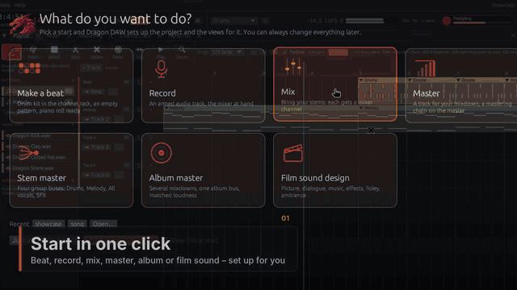

</div>

---

Dragon DAW is a desktop DAW that runs entirely on your machine, with no server, no account and no network
(except an optional check for new versions). It brings together:

- 🥁 an **FL Studio-style beat workflow**: channel rack, step sequencer, pattern clips and piano roll;
- 🎙️ **Pro Tools-style recording and editing**: recording channels, count-in, punch, takes and comping, a sample-accurate playlist;
- 🩹 **iZotope RX and Melodyne-style audio repair and pitch correction** built in;
- 🎛️ a **mixer with routing cables**, sends, sidechains, VCAs and plugin delay compensation;
- 🏁 **mastering**: BS.1770 loudness, a live 3D spectrum, the master chain, album and stem mastering, loudness-normalised export.

When it opens, it asks what you want to do (make a beat, record, mix, master, stem or album master, film sound)
and sets up the project and the views for it. Guided tours explain the app and how to record properly.

This repository started as the **Red Hive** framework. The enterprise parts (backend services, sign-in, users,
documents, invoices, reports, workflows and module hot-swap) have been removed. The desktop framework is kept:
docking, command pool, shortcuts, palette, navigation and i18n. Dragon DAW is now the one app it hosts.

## ✨ Features

| | |
|---|---|
| 🚀 **Start screen** | "What do you want to do?" – **Make a beat, Record, Mix, Master, Stem master, Album master or Film sound design**: each sets up the tracks, buses, chains and views for it. Recent projects, an empty project or the tour are one click away |
| 🌊 **Dragon Wave synth** | A wavetable synth built in: 3 wavetable oscillators (12 factory tables, or drop any audio file to make your own), up to 16-voice unison with detune / blend / stereo width, 8 warp modes (sync, bend, PWM, FM, fold, crush …), sub and noise oscillators, 2 filters (low / high / band pass, notch, comb, formant) in series or parallel, 4 envelopes, 4 LFOs (tempo sync, one-shot), a mod matrix, 4 macros, a 12-slot FX rack, mono / legato / glide and 17 presets from supersaws to growl basses — all automatable |
| 🥁 **Make beats** | Channel rack with step sequencer (per-step velocity, swing, up to 64 steps), **Fill** a channel every step, every 2 / 3 / 4 / 8 steps, off-beats or backbeat (plus invert, shift and clear), drop a sample on a channel to replace its sound, patterns as clips with **clone / make unique / split by channel / split at a bar**, pattern / song mode, a built-in synthesised **Dragon Kit** so a fresh install makes sound with no sample library, sampler (slices, glide, a **volume envelope** drawn over the waveform), subtractive synth (3 oscillators, unison, SVF filter, envelopes, LFO), drum pads with velocity layers and choke groups |
| 🎹 **Piano roll** | Big, labelled tool buttons (draw, paint, select, slice, delete, mute, slip, play, zoom), drag notes (Shift = copy), arrow-key nudge, snap, **key + scale** (26 scales) with snap-to-scale, chord stamps and progressions, arpeggiator, strum, flam, quantize, legato, humanize, slide notes, velocity lane, ghost notes, typing keyboard, retro MIDI capture |
| 🎙️ **Record** | **Recording channels in the mixer** (`+ record`): pick the interface **input** (mono 1, 2 … or stereo 1+2 …), **monitoring** (Auto / Always / Off) and the channel it records **into**; arm from the strip; metronome with count-in, loop and punch, automatic latency compensation, takes in lanes with **comping**, MIDI note recording. **Help › How to record** walks you through interface, input, level, monitoring and the take |
| ✂️ **Arrange & edit** | Playlist with audio, pattern and **automation clips**, a **picker panel**, **fade handles on every audio clip** (drag the top corners; the curve, the faded part and the waveform follow, the length shows in ms), clip gain handle, **compact mode** for many tracks, Ctrl + right-drag zoom to area, multi-select, Shift+drag to clone, a **slice tool** across tracks, grouped clips to new tracks (same mixer channel), reverse, pitch, varispeed and **time-stretch** (WSOLA), fit-to-tempo, markers, tempo and signature changes, unlimited undo with a history list |
| 🔊 **Audio clip window** | Double-click an audio clip: waveform with fades, play from any point, normalize / reverse / fit tempo, level, fades with three shapes, pitch and time, and big **Pitch correction** and **Audio repair** buttons |
| 🩹 **Audio repair** (RX-style) | Spectrogram you can zoom and select in (time range, or a time × frequency box), **"Check the recording"** finds hum, clicks, clipping and background noise and fixes each with one click; **de-noise** (learn the noise), **de-hum**, **de-click**, **de-clip**, **distortion repair**, **de-reverb**, **spectral attenuate**, gain – each with **Preview** before **Apply**, A/B against the original, Ctrl+Z to undo |
| 🎯 **Pitch correction** (Melodyne-style) | Detected notes as blobs with their pitch curves, **move** (semitone snap, Alt = free), **vibrato** (scale a note's drift 0–200 %), **split**, rubber-band and Ctrl+A selection, arrows / Ctrl+arrows / Alt+arrows for semitone / octave / 10 cents, **Correct pitch** macro, zoom in time and pitch, its own undo |
| 🎛️ **Mix** | FL Studio-style mixer with **hanging routing cables** (only for the selected channel), route arrows and send knobs, **large effect slots** (drag to reorder, bypass, mix, gain-reduction), pre/post-fader sends, buses, sidechains, VCAs, width, polarity, solo-safe, **compact strips**, **auto-balance**, **plugin delay compensation**, automation lanes (read / write / touch / latch / trim), MIDI learn |
| 🧪 **Stock effects** | **27 effects, each designed as one device** (faceplate, engraved sections, live display that's also a control, A/B, presets, full screen, a **hint bar** showing what you tweak). Highlights: 24-band EQ after Pro-Q, **4-band multiband dynamics after the McDSP MC404**, soft / hard **clipper**, compressor with eight styles, limiter, de-esser, gate, transient designer, multiband saturator, reverb, delay, **Dragon Tune** real-time pitch correction, Class-A Strip, Drum Bus, Clean Voice, Dragon Particle one-knob mastering. Every effect has a **Hammerstein tab**: the harmonic distortion its current settings produce, measured live |
| 🏁 **Master** | Momentary / short-term / integrated LUFS and true peak (ITU-R BS.1770), streaming / broadcast / club targets, a **real-time 3D heat-map spectrum** (frequency × level × the last 5 seconds), the **master chain** shown and edited as a signal flow, a **reference track** comparison, **album master** (matched loudness across songs) and **stem master** (group buses) |
| 💾 **Export** | A clear export dialog: WAV 16 / 24 / 32-float, FLAC, MP3, Ogg Vorbis, 44.1–96 kHz, song / loop / pattern, tail, dither, mono, **stems**, normalise to LUFS or peak, bounce-in-place, MIDI export |
| 🔌 **Plugins** | CLAP and VST3 instruments and effects, **crash-isolated scanning**, plugin GUIs embedded in native windows that resize and go full screen, sidechain, full plugin state saved, latency reported to PDC |
| 🎛️ **Performance & hardware** | Clip launcher (tracks × patterns, launch on the bar), Mackie Control surfaces with motor faders and LEDs |
| 🔊 **Surround & Atmos** | 5.1, 7.1 and 7.1.4 mixes with a surround panner, multichannel WAV export and Dolby Atmos ADM BWF |
| 🎬 **Video** | Import a video, watch it in sync with timecode, its soundtrack on a track, export the video with your mix. **ffmpeg** comes with the Windows download, or *Get ffmpeg* installs it |
| 🎓 **Tours & quests** | Click-through **tours** over the real interface (the basics, and how to record) and optional **Dragon Quests**: quests that teach the workflow, XP and dragon levels, a daily streak and celebrations (off with *Reduce motion*) |
| 🔄 **Updates** | Tells you when a new version is out, with **Download** and – on Windows – **Install and restart** (Help › Check for updates; can be turned off) |
| 🛟 **Safety** | Project folders with `Samples/`, `Recordings/`, `Renders/` and `Backup/`, autosave with crash recovery, numbered backups, missing-file relinking, crash reports and **safe mode** for projects with a crashing plugin |
| 🪟 **Desktop shell** | VS-style docking (tabs, splits, floating windows, saved layout), menus, a command palette (`Ctrl+Shift+P`), rebindable shortcuts **matching FL Studio**, drag & drop from the file manager, the Dragon logo, icon and startup sound |

The full list, compared item by item with the prioritised roadmap, is in **[docs/FEATURES.md](docs/FEATURES.md)**.

## 📸 Screenshots

> Real screenshots of the app on Linux.

### 🚀 Start and make beats

<table>
  <tr>
    <td width="50%">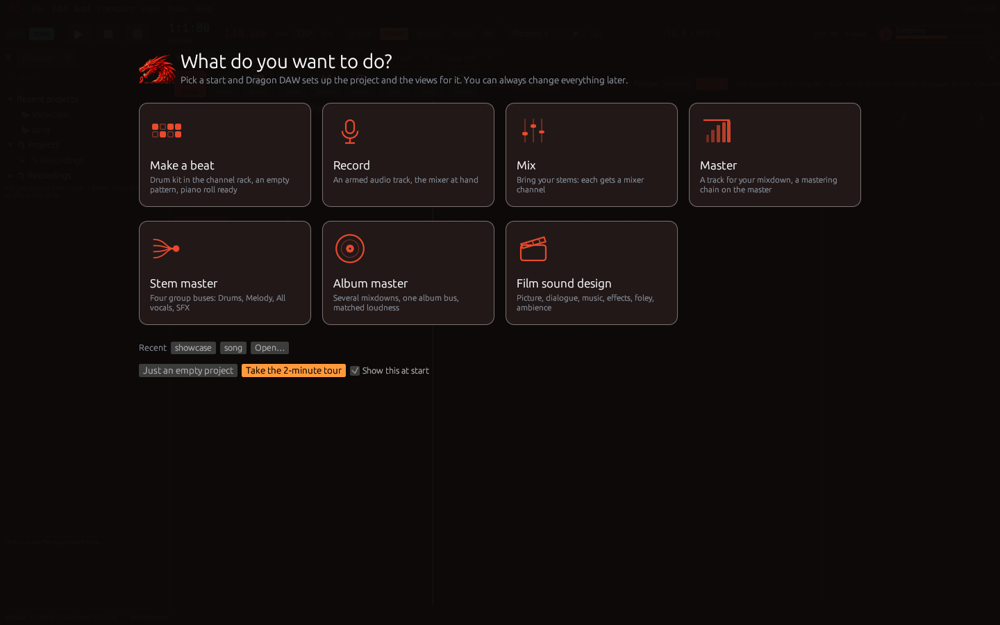</td>
    <td width="50%">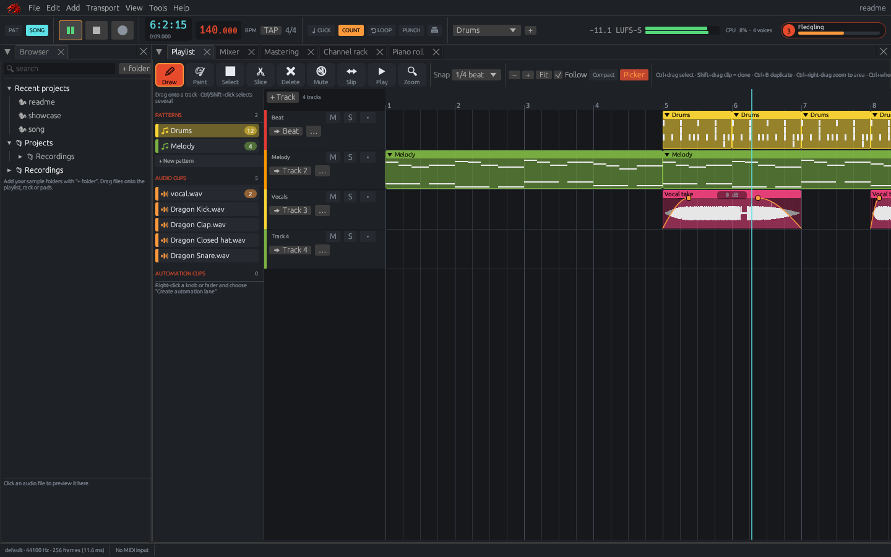</td>
  </tr>
  <tr>
    <td align="center"><b>Start screen</b> — pick a beat, a recording, a mix, a master …</td>
    <td align="center"><b>Playlist</b> — big tool buttons, audio clips with draggable fades</td>
  </tr>
  <tr>
    <td width="50%"></td>
    <td width="50%"></td>
  </tr>
  <tr>
    <td align="center"><b>Channel rack</b> — fill every 2, 4, 8 steps, off-beats, backbeat</td>
    <td align="center"><b>Piano roll</b> — scales, chord stamps and progressions</td>
  </tr>
  <tr>
    <td width="50%"></td>
    <td width="50%">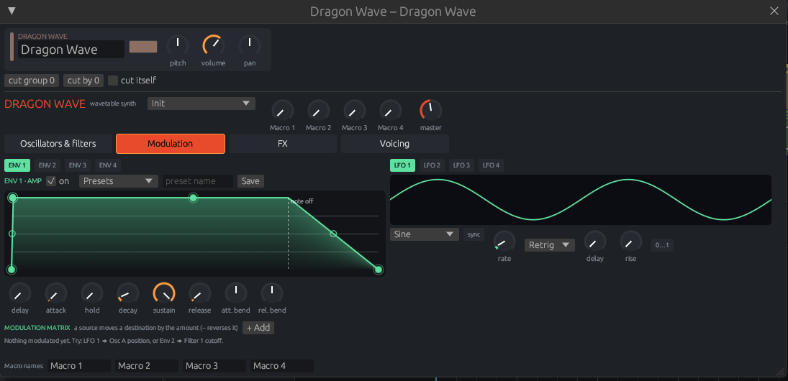</td>
  </tr>
  <tr>
    <td align="center"><b>Dragon Wave</b> — wavetable synth with 3D table views and draggable filter curves</td>
    <td align="center"><b>Modulation</b> — 4 envelopes, 4 LFOs, a mod matrix and 4 macros</td>
  </tr>
</table>

### 🎙️ Record, repair and tune

<table>
  <tr>
    <td width="50%">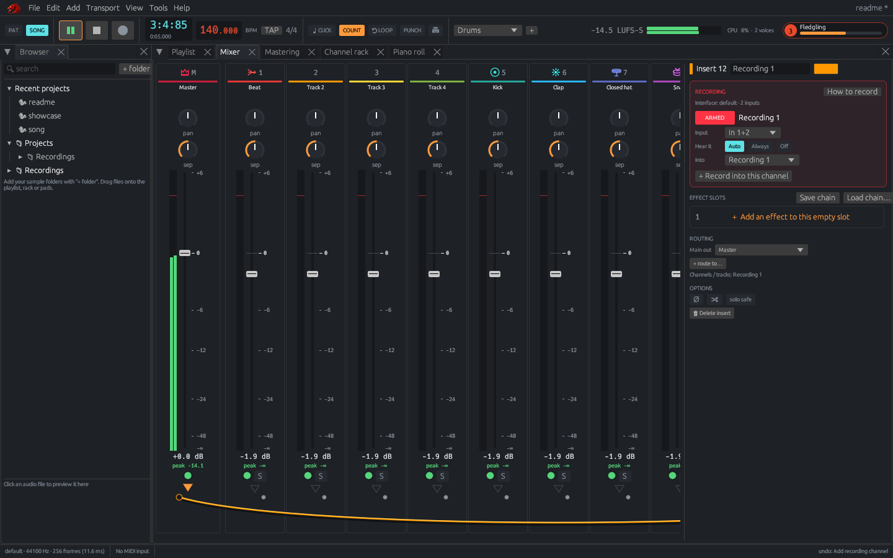</td>
    <td width="50%"></td>
  </tr>
  <tr>
    <td align="center"><b>Recording channels</b> — input, monitoring, where it records into</td>
    <td align="center"><b>How to record</b> — a guided tour over the real controls</td>
  </tr>
  <tr>
    <td width="50%">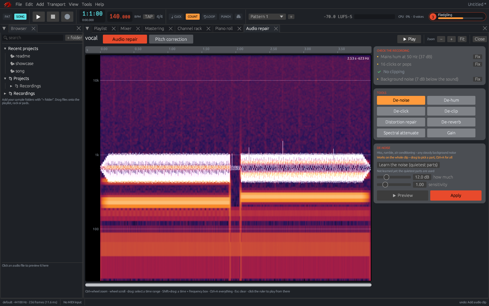</td>
    <td width="50%">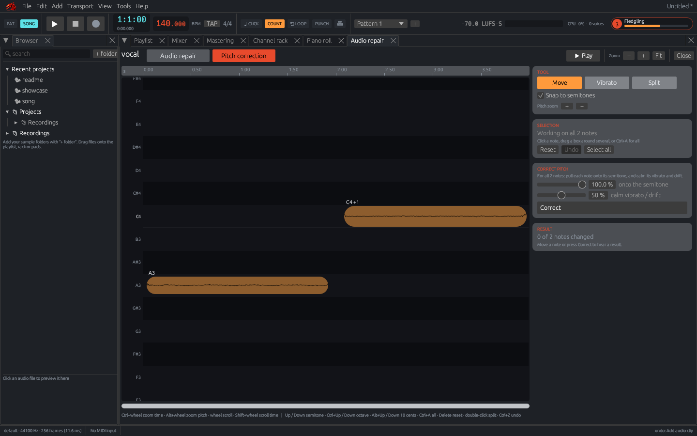</td>
  </tr>
  <tr>
    <td align="center"><b>Audio repair</b> — finds hum, clicks, clipping and noise; fix with one click</td>
    <td align="center"><b>Pitch correction</b> — move notes, calm the vibrato, split</td>
  </tr>
  <tr>
    <td width="50%">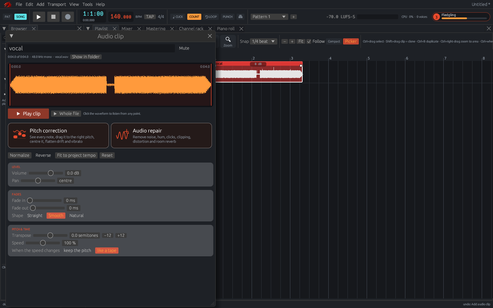</td>
    <td width="50%"></td>
  </tr>
  <tr>
    <td align="center"><b>Audio clip window</b> — fades, level, pitch and the repair tools</td>
    <td align="center"><b>Compact mode</b> — every channel on one screen</td>
  </tr>
</table>

### 🎛️ Mix and master

<table>
  <tr>
    <td width="50%">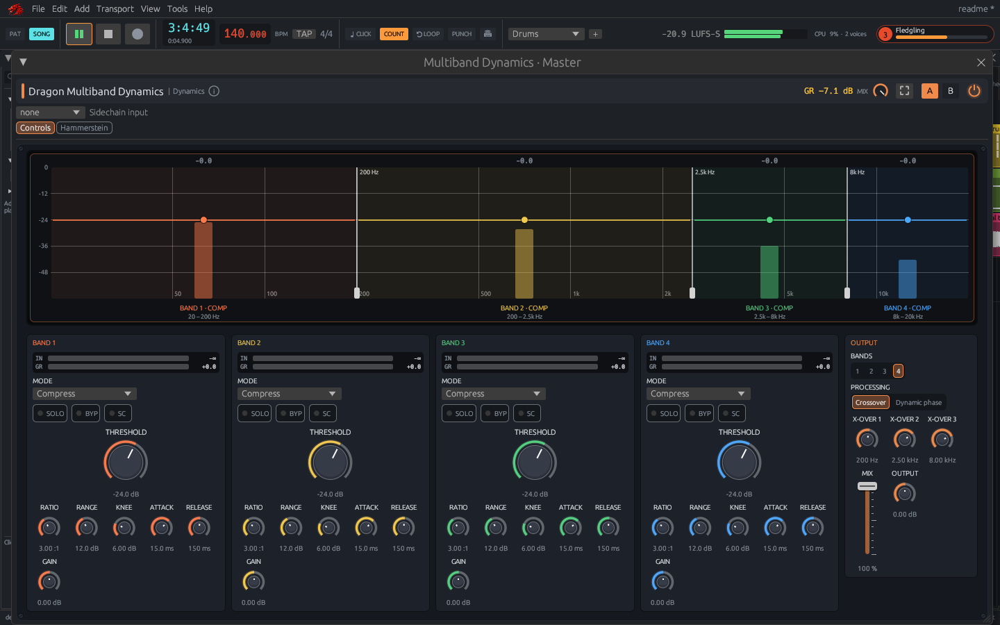</td>
    <td width="50%">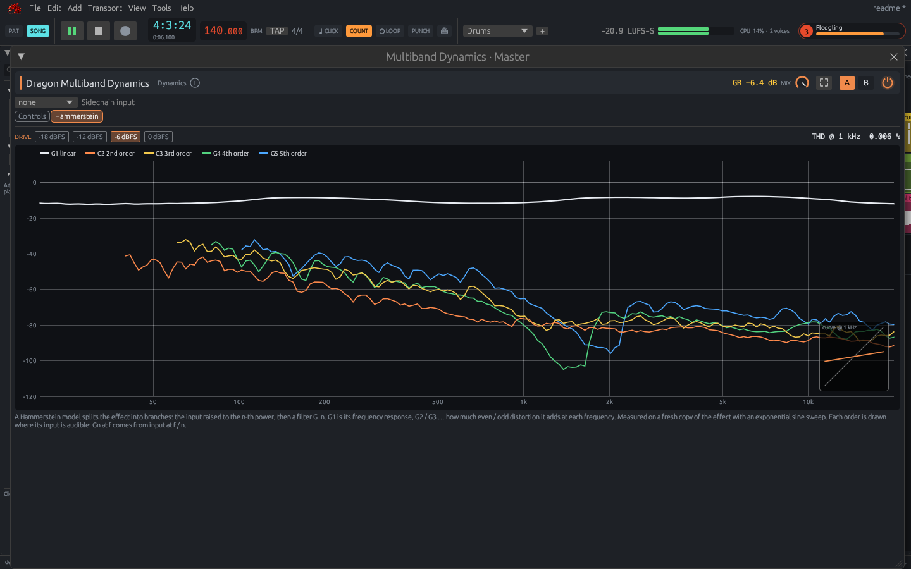</td>
  </tr>
  <tr>
    <td align="center"><b>Multiband dynamics</b> — four bands, MC404-style</td>
    <td align="center"><b>Hammerstein tab</b> — the harmonics each effect adds</td>
  </tr>
  <tr>
    <td width="50%"></td>
    <td width="50%"></td>
  </tr>
  <tr>
    <td align="center"><b>Mastering</b> — LUFS, 3D heat-map spectrum, master chain</td>
    <td align="center"><b>Routing cables</b> — drag a cable between strips</td>
  </tr>
  <tr>
    <td width="50%">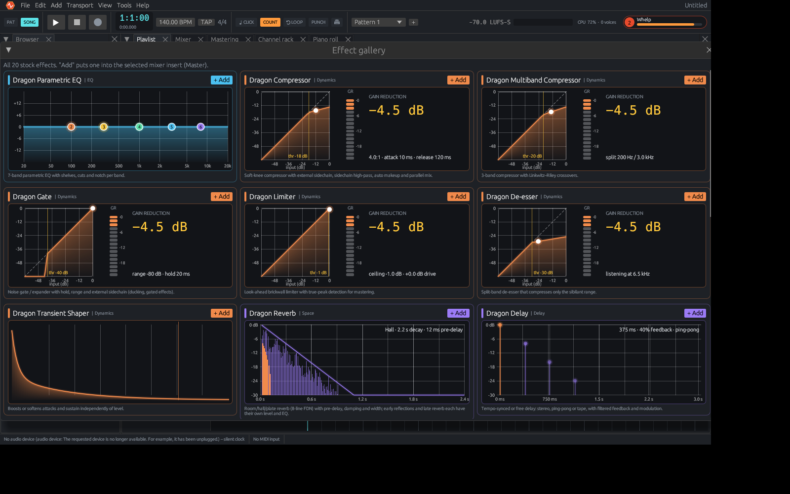</td>
    <td width="50%"></td>
  </tr>
  <tr>
    <td align="center"><b>Effect gallery</b> — every stock effect with its live display</td>
    <td align="center"><b>Dragon Quests</b> — quest celebration with embers and XP bar</td>
  </tr>
</table>

The look of the effect editors and the quest celebration follows design references generated with
**Higgsfield AI**: an [effect-suite UI sheet](docs/images/design/higgsfield-effect-suite-reference.jpg) and an
[animated level-up GIF](docs/images/design/higgsfield-levelup-reference.jpg). Both are re-created procedurally in
egui so they scale, animate live and respect *Reduce motion*.

## 🚀 Quick start

**📦 Download a build:** the [latest nightly](https://github.com/zenoxart/DragonDAW-RS/releases/tag/nightly)
(built from `main` after every green CI run) or a [versioned release](https://github.com/zenoxart/DragonDAW-RS/releases)
– 🪟 Windows x64, 🐧 Linux x64, 🍎 macOS Apple Silicon and Intel. Unzip it to a folder of your own (not
*Program Files*) so the built-in updater can replace it. The Windows zip includes ffmpeg for video.

**🛠️ Or build it yourself:**

```bash
# Linux: ALSA headers for audio and MIDI
sudo apt install libasound2-dev

cargo run --release -p dragon-daw            # the DAW
cargo run --release -p dragon-daw -- song.dragon
cargo build --release -p dragon-cli          # the `dragon` tool (put it next to the app for isolated plugin scans)
```

Optional on Linux / macOS: install **ffmpeg** (with `ffprobe`) for the video features.

**🛟 If a project crashes the app** (usually a third-party plugin): the next start says which plugin was
loading and offers safe mode, with plugins off or without their saved settings. `dragon-daw --safe song.dragon`
does the same. Crash reports go to `%LOCALAPPDATA%\DragonDAW\Crash` on Windows.

### ⌨️ Useful keys

| Key | Action | Key | Action |
|---|---|---|---|
| `Space` | play / pause | `F5` `F6` `F7` `F9` | playlist, channel rack, piano roll, mixer |
| `R` | record | `L` | pattern / song mode |
| `Ctrl+Z` / `Ctrl+Y` | undo / redo | `Ctrl+T` | typing keyboard to piano |
| `Ctrl+S` | save | `Ctrl+R` | export |
| `Ctrl+Shift+P` | command palette | `F8` / `F10` | effect gallery / options |
| `Ctrl` + right-drag | zoom into the box | `Ctrl` + right-click | zoom out |
| middle-drag | pan | `Alt` + wheel | track / key height |
| `←` `→` `↑` `↓` | nudge selected notes (`Shift` = octave) | `Shift` + drag | copy notes |
| `Ctrl+A` in Audio repair | select all notes / the whole clip | `↑` `↓` in Pitch correction | move notes a semitone |

Every shortcut can be changed in **Options › Keyboard shortcuts**. **Help** has *Take the tour*,
*How to record* and *Check for updates*.

## 🏗️ Architecture

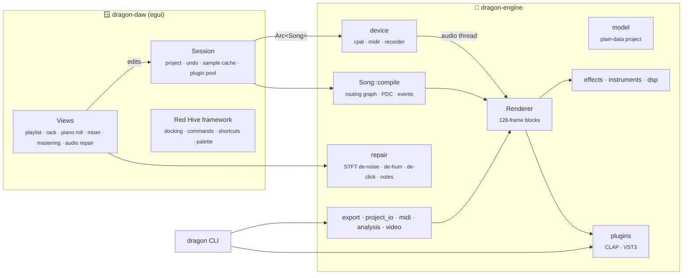

- 📄 **The project is plain data.** Every edit snapshots the project for undo, and the session compiles it into an
  immutable `Song` (routing order, delay lines for plugin delay compensation, pattern events, clip timing). The
  audio thread swaps it in without locking the UI.
- 🔁 **One renderer for everything.** Real-time playback, export, stems, bounce-in-place and the CLI all run the
  same `Renderer`, so what you hear is what you export.
- 🧠 **Processors survive recompiles.** A pool keeps effect, instrument and plugin instances by id. Turning a knob
  recompiles the song but doesn't reset reverb tails or reload plugins.
- 🩹 **Repairs are non-destructive.** Audio repair and pitch correction render to a new file next to the
  recordings and point the clip at it; undo points it back.
- 🔇 **No device? Keep working.** If no audio device can be opened, a silent clock drives the same renderer. The
  transport, meters, editing and export all keep working.

More detail is in [ARCHITECTURE.md](ARCHITECTURE.md).

## 🔌 Plugins

Dragon DAW looks for plugins in the standard CLAP and VST3 folders of each platform, plus any folders you add in
**View › Plugin manager**. Scanning runs `dragon scan-plugin <format> <path>` in a child process for each file,
so a plugin that crashes while loading is just skipped. Instruments go into the channel rack; effects go into
any mixer insert slot. The host:

- 🎵 sends notes and sample-accurate parameter events,
- ⏱️ reports the plugin's latency to delay compensation,
- 💾 stores the plugin's full state in the project,
- 🔀 passes a sidechain signal (CLAP second input port, VST3 aux bus),
- 🪟 embeds the plugin's own GUI in a native window (X11 on Linux, Win32 on Windows; macOS falls back to CLAP
  floating windows and the generic editor).

The host is tested against small CLAP and VST3 plugins in [`crates/test-plugins`](crates/test-plugins): a gain
effect and a sine instrument written for this repository.

## ⌨️ Command line

```text
dragon render <project> <out.wav|out.flac|out.mp3|out.ogg|folder> [--format wav16|wav24|wav32|flac16|flac24|mp3|ogg]
              [--rate 48000] [--lufs -14] [--peak -1] [--stems] [--mono] [--no-plugins]
dragon info <project>          tracks, patterns, length, missing files
dragon new <project>           writes an empty project
dragon loudness <audio>        integrated LUFS, true peak, sample peak
dragon analyze <audio>         BPM and key detection
dragon scan [folder …]         plugin scan, each file in its own process
```

## 📁 Repository layout

```text
crates/
├── engine/             dragon-engine: model, renderer, DSP, effects, instruments, repair, plugins, device I/O, export
├── app/                dragon-daw: the desktop app (views, session, audio backend, tours, updater)
├── test-plugins/       CLAP + VST3 plugins used by the host tests
├── client/framework/   Red Hive desktop framework (docking, commands, shortcuts, i18n, widgets)
└── shared/
    ├── contracts/      command, shortcut and UI primitives
    └── monads/         Res<T>, Error, Validator
tools/dragon-cli/       the `dragon` command-line tool
docs/                   feature coverage, images
```

## 🧪 Development

```bash
cargo test --workspace                 # engine, host-with-real-plugins, framework and app tests
cargo clippy --workspace --all-targets -- -D warnings
cargo fmt --all                        # rustfmt.toml: 220 columns
```

The engine tests render audio and assert on the result: sample-accurate clip and step timing, swing, routing and
solo, plugin delay compensation, automation, effect stability, limiter ceiling, LUFS, time-stretch, export, MIDI
round trips, BPM and key detection, comping, autosave, and the repair tools (noise, hum, clicks and clipping
measurably removed, notes detected and moved). The app tests drive the views with synthetic mouse and keyboard
input (dragging fades, filling steps, the tours, recording channels, compact mode …). The plugin tests load the
in-repo CLAP and VST3 plugins through the real host.

### 🔄 CI/CD

GitHub Actions runs on every push to `main` and every pull request – see the
[CI runs](https://github.com/zenoxart/DragonDAW-RS/actions/workflows/ci.yml),
[release runs](https://github.com/zenoxart/DragonDAW-RS/actions/workflows/release.yml) and
[releases](https://github.com/zenoxart/DragonDAW-RS/releases):

| Workflow | Jobs |
|---|---|
| [`ci.yml`](.github/workflows/ci.yml) | rustfmt and Clippy (`-D warnings`), the full test suite on Linux under Xvfb (including the CLAP/VST3 host tests), tests on Windows and macOS, and a build check on the minimum Rust version (1.89) |
| [`release.yml`](.github/workflows/release.yml) | after every green CI run on `main`, release builds for all four platforms are published as the rolling [`nightly`](https://github.com/zenoxart/DragonDAW-RS/releases/tag/nightly) pre-release; on a `v*` tag, a versioned GitHub release. Each build knows its commit and channel, so the app's update check offers the right download. The Windows zip bundles ffmpeg |

Dependabot opens weekly grouped updates for Cargo crates and the actions themselves.

To publish a release:

```bash
git tag v2.1.0
git push origin v2.1.0
```

## 🤝 Contributing

Issues and pull requests are welcome. Please keep code, comments and docs in English, run the tests and clippy,
and add a test for new engine behaviour that renders audio and checks it.

## 📄 License

Copyright © ZenoxArt. Licensed under the [Apache License, Version 2.0](LICENSE).
